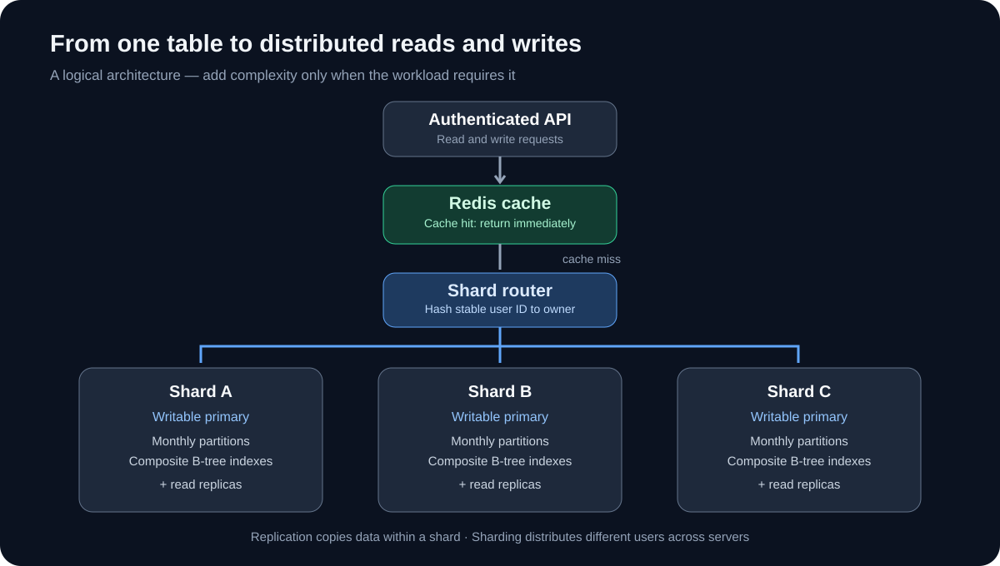
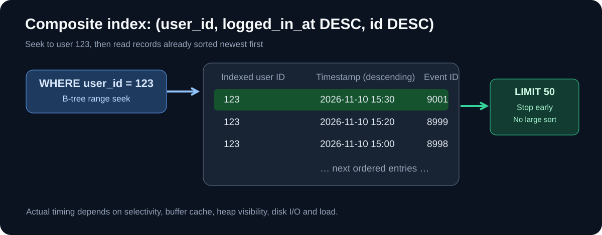
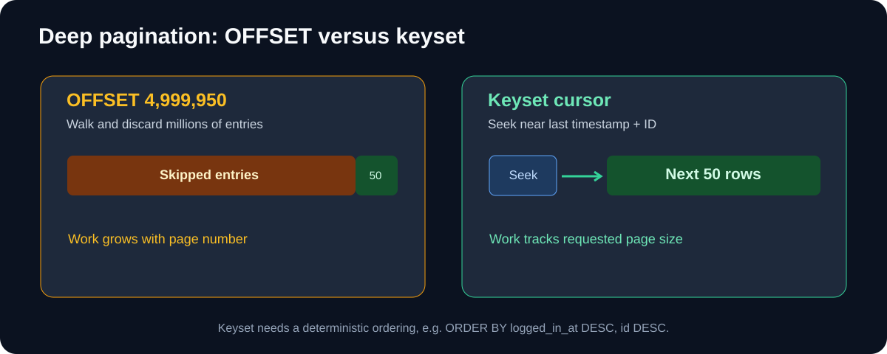

One billion rows. One table. One innocent query asking for a user's login history. How complicated could that be?

The answer depends less on the *number* of rows than on how the database finds them, how many it must return, and how many other people are asking at the same time. We'll start with a single PostgreSQL table and progressively evolve it into a distributed architecture. No magic "just use Redis" at step one.

Our workload: show an authenticated user their **50 newest login events**, then page backward through their history. Names, emails, and phones are **not unique**: one user might have millions of events.

> [!NOTE]
> All row counts, rates, sizes, and latencies in examples are illustrative, not measured benchmarks. Validate changes with `EXPLAIN (ANALYZE, BUFFERS)` and production-like workloads.

## Table of Contents

1. [Stage 1 — One table](#stage-1--one-table)
2. [Stage 2 — Composite B-tree indexes](#stage-2--composite-b-tree-indexes)
3. [Stage 3 — Keyset pagination](#stage-3--keyset-pagination)
4. [Stage 4 — Covering indexes](#stage-4--covering-indexes)
5. [Stage 5 — Partitioning](#stage-5--partitioning)
6. [Stage 6 — Redis caching](#stage-6--redis-caching)
7. [Stage 7 — Read replicas](#stage-7--read-replicas)
8. [Stage 8 — Sharding](#stage-8--sharding)
9. [Final architecture and checklist](#final-architecture-and-checklist)

---

## Stage 1 — One table

A login-history table is an **event table**, not a user directory. An email can appear repeatedly; more importantly, a stable `user_id` should identify the owner of each event.

~~~sql title="01-schema.sql"
CREATE TABLE login_logs (
    id BIGINT GENERATED ALWAYS AS IDENTITY PRIMARY KEY,
    user_id BIGINT NOT NULL,
    name TEXT,
    email TEXT,
    phone TEXT,
    logged_in_at TIMESTAMPTZ NOT NULL DEFAULT NOW(),
    ip_address INET,
    success BOOLEAN NOT NULL
);
~~~

Copying name, email, and phone into logs may preserve history, but it also duplicates personal information. In production, minimize and retain only the fields the product actually needs.

The naïve query is:

~~~sql
SELECT *
FROM login_logs
WHERE user_id = 123;
~~~

If there is no suitable index, PostgreSQL may scan an enormous table. More fundamentally, a user could have ten million matching rows; even perfect indexing doesn't make returning all ten million inexpensive.

Let's measure a query rather than guess:

~~~sql
EXPLAIN (ANALYZE, BUFFERS)
SELECT id, logged_in_at, success
FROM login_logs
WHERE user_id = 123;
~~~

`EXPLAIN` exposes the access path. `ANALYZE` actually executes the query, while `BUFFERS` reports shared-cache hits and reads. Be careful running it against expensive writes or large production queries.

Two distinct costs matter: **locating matches** and **fetching/returning matches**. A selective B-tree seek is intuitively `O(log N)` plus the cost of visiting `K` matched rows; a sequential scan is roughly `O(N)`. These are mental models, not guaranteed latency formulas. PostgreSQL may quite reasonably choose a sequential scan for queries matching a large fraction of a table.

## Stage 2 — Composite B-tree indexes

First, create a non-unique index:

~~~sql
CREATE INDEX idx_logs_user ON login_logs (user_id);
~~~

This finds all events for a user but does not necessarily supply them in timestamp order. Our **actual** query is:

~~~sql
SELECT id, logged_in_at, success
FROM login_logs
WHERE user_id = 123
ORDER BY logged_in_at DESC, id DESC
LIMIT 50;
~~~

An index on `user_id` alone may require PostgreSQL to examine and sort many matching events. Instead, index the filter **and** sort order:

~~~sql
CREATE INDEX idx_logs_user_time
ON login_logs (user_id, logged_in_at DESC, id DESC);
~~~

The index groups entries by user, then orders them by descending timestamp and ID. PostgreSQL can seek to the user's range and read about 50 entries rather than sorting their entire history. The `id` tie-breaker guarantees deterministic ordering when timestamps are equal.

A simplified possible query plan:

~~~text
Limit
  -> Index Scan using idx_logs_user_time on login_logs
       Index Cond: (user_id = 123)
~~~

This is an example plan **shape**, not captured output.

| Index | Effect on our history query |
| --- | --- |
| `(user_id)` | Finds the user; may still need sorting |
| `(logged_in_at DESC)` | Sorted by time; not selective by user |
| `(user_id, logged_in_at DESC, id DESC)` | Matches filtering and ordering |
| `(id, user_id)` | Poor leading-key choice for history |

The composite index can often serve simple `WHERE user_id = ?` queries too, so a standalone user index may become redundant. Don't drop indexes without checking other workloads. Each one consumes storage, RAM, and extra work during inserts.

> [!TIP]
> Three separate indexes on `name`, `email`, and `phone` are not equivalent to one composite index that matches a specific query. Design indexes from real `WHERE`, `ORDER BY`, and `LIMIT` patterns.

## Stage 3 — Keyset pagination

The first page is fast. What about page 100,000?

~~~sql
SELECT id, logged_in_at, success
FROM login_logs
WHERE user_id = 123
ORDER BY logged_in_at DESC, id DESC
LIMIT 50 OFFSET 4999950;
~~~

Even with the right index, PostgreSQL generally walks past approximately five million qualifying entries. `OFFSET` doesn't jump directly into the middle of a B-tree result set.

**Keyset pagination** says: *give me the next 50 records older than the last record I saw.*

First page:

~~~sql
SELECT id, logged_in_at, success
FROM login_logs
WHERE user_id = $1
ORDER BY logged_in_at DESC, id DESC
LIMIT 50;
~~~

Suppose its last row is timestamp `2026-11-10T14:50:00Z`, ID `101`. The next request uses:

~~~sql
SELECT id, logged_in_at, success
FROM login_logs
WHERE user_id = $1
  AND (logged_in_at, id) < ($2::timestamptz, $3::bigint)
ORDER BY logged_in_at DESC, id DESC
LIMIT 50;
~~~

Here `$2` and `$3` contain the last row's timestamp and ID. PostgreSQL can seek into the composite index near that pair, rather than discard millions of previous entries.

| Property | OFFSET | Keyset |
| --- | --- | --- |
| First page | Fast | Fast |
| Deep sequential pages | Slows with skip distance | Usually stable |
| Jump to arbitrary page number | Supported | Not natural |
| Concurrent inserts | Page positions may shift | More stable |
| Deterministic tie-breaker | Recommended | Essential |

A cursor token should be validated and scoped to authenticated user and filters. Keyset pagination alone doesn't guarantee a consistent historical snapshot across many HTTP requests, especially if older records can be changed or deleted.

## Stage 4 — Covering indexes

Our index contains `user_id`, `logged_in_at`, and `id`. But our UI requests `ip_address` and `success` too:

~~~sql
SELECT id, logged_in_at, ip_address, success
FROM login_logs
WHERE user_id = 123
ORDER BY logged_in_at DESC, id DESC
LIMIT 50;
~~~

An ordinary index scan can find row references quickly yet still visit heap pages to fetch those extra columns.

PostgreSQL supports **included payload columns**:

~~~sql
CREATE INDEX idx_logs_user_time_cover
ON login_logs (user_id, logged_in_at DESC, id DESC)
INCLUDE (ip_address, success);
~~~

Keys decide search and order; included columns supply data without affecting ordering.

The desired plan may be:

~~~text
Limit
  -> Index Only Scan using idx_logs_user_time_cover
       Index Cond: (user_id = 123)
       Heap Fetches: 0
~~~

But **index-only** does not always mean zero heap reads. PostgreSQL uses MVCC and a **visibility map**. If a heap page isn't marked all-visible, PostgreSQL must check the heap to establish row visibility. New, actively written login pages may not yet qualify.

Benchmark using:

~~~sql
EXPLAIN (ANALYZE, BUFFERS)
SELECT id, logged_in_at, ip_address, success
FROM login_logs WHERE user_id = 123
ORDER BY logged_in_at DESC, id DESC LIMIT 50;
~~~

Check `Index Only Scan`, `Heap Fetches`, buffer reads, and elapsed time. A wider index also uses more storage and increases insert cost. Included columns can reduce B-tree deduplication opportunities. If the endpoint needs just `id` and `logged_in_at`, our original index may already cover the query.

## Stage 5 — Partitioning

Now suppose our logs grow toward ten billion records. **More rows alone do not require partitioning.** Partition when time-bounded queries or retention management make it worthwhile.

Conceptually:

~~~text
login_logs (logical table)
 ├─ login_logs_2026_10  + local index
 ├─ login_logs_2026_11  + local index
 ├─ login_logs_2026_12  + local index
 └─ ...
~~~

PostgreSQL range partitioning routes records by timestamp. Importantly, a primary key or unique constraint on the partitioned parent must include the partition key:

~~~sql title="02-partitioned-schema.sql"
CREATE TABLE login_logs (
    id BIGINT GENERATED ALWAYS AS IDENTITY,
    user_id BIGINT NOT NULL,
    logged_in_at TIMESTAMPTZ NOT NULL,
    ip_address INET,
    success BOOLEAN NOT NULL,
    PRIMARY KEY (id, logged_in_at)
) PARTITION BY RANGE (logged_in_at);

CREATE TABLE login_logs_2026_11
PARTITION OF login_logs
FOR VALUES FROM ('2026-11-01 00:00:00+00')
           TO ('2026-12-01 00:00:00+00');

CREATE TABLE login_logs_2026_12
PARTITION OF login_logs
FOR VALUES FROM ('2026-12-01 00:00:00+00')
           TO ('2027-01-01 00:00:00+00');

CREATE INDEX idx_logs_user_time
ON login_logs (user_id, logged_in_at DESC, id DESC);
~~~

This schema is an **alternative** to the Stage 1 table, not an in-place `ALTER TABLE` recipe. The parent index maps to local physical indexes. Date boundaries use UTC and exclude their upper endpoint. Pre-create partitions for your actual retention window and upcoming dates; otherwise an insert with no matching partition fails.

The composite primary key enforces uniqueness of **`(id, logged_in_at)`**, not globally unique `id` alone. An identity sequence generates values, but doesn't itself create a global unique constraint across partitions.

### Partition pruning

~~~sql
SELECT id, logged_in_at, success
FROM login_logs
WHERE user_id = 123
  AND logged_in_at >= '2026-11-01 00:00:00+00'
  AND logged_in_at <  '2026-12-01 00:00:00+00'
ORDER BY logged_in_at DESC, id DESC
LIMIT 50;
~~~

PostgreSQL can exclude all partitions except November. Within that partition, the B-tree still finds the user's events.

But a query without a timestamp condition **cannot prune monthly partitions by user ID alone**. It may need to combine ordered results from several partitions. In that situation, a well-indexed single table may perform as well or better.

### Fast data retention

If you keep only 12 months of events, mass `DELETE` operations create row-by-row index changes, dead tuples, and vacuum work. Removing a fully expired partition is operationally simpler:

~~~sql
ALTER TABLE login_logs
DETACH PARTITION login_logs_2025_12;
-- Archive and verify before removing the detached table:
DROP TABLE login_logs_2025_12;
~~~

Detaching needs appropriate locking and planning, but it can avoid much of the cleanup cost of deleting millions of individual rows. Don't choose thousands of tiny partitions without measuring planning overhead.

## Stage 6 — Redis caching

Indexes minimize one read's cost; they don't stop an API from repeating an identical read 10,000 times.

**Cache-aside** keeps PostgreSQL authoritative and caches frequent query results in Redis:

~~~text
API request
  |
Redis GET
  |--- HIT ----> return cached result
  |
  +--- MISS ---> PostgreSQL SELECT
                    |
                  Redis SET (TTL)
                    |
                  return
~~~

We should selectively cache the latest 50 records, not an entire user's potentially enormous history. A cache key based on a stable authenticated user ID avoids embedding mutable email addresses.

~~~bash
npm install pg redis
~~~

~~~js title="src/login-history.js"
import { Pool } from "pg";
import { createClient } from "redis";

const db = new Pool({
  connectionString: process.env.DATABASE_URL,
  max: 20
});
const redis = createClient({ url: process.env.REDIS_URL });
redis.on("error", console.error);
await redis.connect();

export async function latestLoginHistory(userId) {
  // Take userId from verified authentication, not untrusted input.
  const key = "login-history:v1:user:" + userId + ":latest:50";
  try {
    const value = await redis.get(key);
    if (value !== null) return JSON.parse(value);
  } catch (err) {
    console.error("Cache read failed:", err);
  }

  const { rows } = await db.query(
    "SELECT id, logged_in_at, ip_address, success " +
    "FROM login_logs WHERE user_id = $1 " +
    "ORDER BY logged_in_at DESC, id DESC LIMIT 50",
    [userId]
  );

  try {
    await redis.set(key, JSON.stringify(rows), {
      EX: 30 + Math.floor(Math.random() * 11)
    });
  } catch (err) {
    console.error("Cache write failed:", err);
  }
  return rows;
}
~~~

This is a teaching baseline, not a fully coherent distributed cache implementation. Cache lookups should fail open to PostgreSQL, but database concurrency **must be bounded** to avoid a cascade during Redis outages.

### Invalidation is harder than getting a cache hit

After inserting a login, commit it to PostgreSQL **before** deleting the affected Redis key:

~~~js
await db.query(
  "INSERT INTO login_logs (user_id, logged_in_at, ip_address, success) " +
  "VALUES ($1, NOW(), $2, $3)",
  [userId, ipAddress, success]
);
await redis.del("login-history:v1:user:" + userId + ":latest:50");
~~~

There's still a race: reader A starts fetching old data, writer B commits and deletes the key, then A populates Redis with its stale result. A short TTL limits staleness but doesn't ensure read-your-writes consistency.

For strict freshness, read from the authoritative primary or use a stronger cache version/invalidation protocol. Durable invalidation events are useful when processes can crash after commit. Cached IP addresses and activity data require privacy-aware retention and access controls.

### Cache stampede

If a popular key expires, thousands of concurrent misses may all query PostgreSQL. Use single-flight request coalescing (within each process), controlled distributed refresh for hot keys when justified, TTL jitter, and pool/concurrency limits.

For illustration, 100,000 reads/sec with a 95% Redis hit rate implies 5,000 DB reads/sec if each miss causes one query. That isn't a latency guarantee. Monitor p95/p99 latency, cache evictions, and miss bursts—not just an average hit rate.

## Stage 7 — Read replicas

After caching, remaining reads may still saturate the primary. PostgreSQL **physical streaming replicas** can serve read-only queries while the primary handles writes.

~~~text
                  Node.js API
                  /         \
              writes       eligible reads
                |               |
           Primary DB       Read router
                |           /       \
           WAL stream  Replica 1   Replica 2
~~~

The primary writes a **write-ahead log (WAL)**; replicas receive and replay those changes. Streaming replication is asynchronous by default.

An illustrative Node.js split:

~~~js title="src/read-write-split.js"
import { Pool } from "pg";

const primary = new Pool({ connectionString: process.env.DB_PRIMARY_URL });
const replicas = [
  new Pool({ connectionString: process.env.DB_REPLICA_1_URL }),
  new Pool({ connectionString: process.env.DB_REPLICA_2_URL })
];
let next = 0;

function pickReplica() {
  return replicas[(next++) % replicas.length];
}

export async function getHistory(userId, requireFresh = false) {
  const pool = requireFresh ? primary : pickReplica();
  return pool.query(
    "SELECT id, logged_in_at, success FROM login_logs " +
    "WHERE user_id = $1 ORDER BY logged_in_at DESC, id DESC LIMIT 50",
    [userId]
  );
}
~~~

Production routing must inspect replica health, lag, connection limits, and failover state.

### Replication lag and consistency

Imagine a login commits on the primary at 10:05. At 10:05:00.100, a replica may still show 10:00 as the newest login. A successful write followed by a stale read violates the user's expectation of **read-your-writes**.

To guarantee a fresh post-write view, read the primary (and bypass stale cache), or wait until a particular replica has replayed a suitable WAL position before using it. Synchronous replication can offer stronger acknowledgment behavior, but guarantees depend on settings and which standby serves the read.

### Failover isn't just switching a hostname

A high-availability controller may promote a standby, but it must prevent **split brain** (two writable primaries), route clients, rebuild replication topology, and safely rejoin the old primary. Async failover can lose transactions acknowledged by the original primary but not yet received by the promoted replica.

**Replicas are not backups.** Accidental deletes can replicate too. Keep independent, restorable backups and point-in-time recovery.

Replicas improve read capacity and availability architecture; they do **not** distribute the writes of one primary across independent writers.

## Stage 8 — Sharding

Suppose one primary cannot handle either write throughput or storage growth despite the previous optimizations. **Sharding** splits the data among independently writable PostgreSQL servers.

~~~text
Authenticated user_id
         |
     Shard router
     /    |     \
 Shard A Shard B Shard C
 users X users Y users Z
   |        |       |
 primary  primary  primary
 + replicas on each shard
~~~

A natural shard key for this workload is `user_id`: all events for one user stay together, making their history a single-shard query. Sharding by timestamp instead would scatter one user's history across servers; sharding by email creates problems when addresses change.

### Why naive modulo breaks at scale

For four physical shards, a simplistic route might be:

~~~js
function shardForUser(userId) {
  return Number(BigInt(userId) % 4n);
}
~~~

Changing to five shards changes the destination for many users without actually moving their data. Reads suddenly go to the wrong place.

### Virtual buckets and a routing map

Instead, deterministically hash each user ID into a fixed set of logical buckets, for example 1,024. A separate mapping assigns each bucket to a physical shard:

~~~text
user_id 123
    |
stable hash
    |
bucket 647 (of 1024)
    |
bucket-to-shard map
    |
Shard B
~~~

To add Shard E, migrate selected buckets and atomically change their ownership once data is synchronized. The stable hash and bucket count remain unchanged. In reality, online migration requires snapshot copying, ongoing change capture, cutover coordination, idempotent retries, and rollback plans.

An interface sketch:

~~~js title="src/shard-router.js"
// bucketForUser must implement one stable, specified hash.
// bucketOwners is maintained by a reliable control plane.
const BUCKET_COUNT = 1024;
const bucketOwners = new Map();
const shardPools = new Map();

export function databaseForUser(userId) {
  const bucket = bucketForUser(userId) % BUCKET_COUNT;
  const owner = bucketOwners.get(bucket);
  const pool = shardPools.get(owner);
  if (!pool) throw new Error("Shard routing unavailable");
  return pool;
}
~~~

This is intentionally **not copy-paste production routing**: it omits the hash implementation, versioned map distribution, routing leases, health checks, and migration orchestration.

Sharding creates hard new problems: cross-shard joins, global unique constraints, distributed transactions, fan-out analytics, hot users, backfills, schema migrations, backups, and fleet-wide failover.

**Partitioning and sharding can coexist.** Each shard may contain monthly partitions and composite indexes, plus its own read replicas. Redis can sit in front of all shards.

## Final architecture and checklist

~~~text
Client
  |
Authenticated API
  |
Redis cache (only selected frequent reads)
  | MISS
  v
Shard router (verified user_id)
  |
Owning shard
  |--------------------------|
Primary DB             Read replica(s)
  |                         |
Monthly partitions + composite indexes
  |
Ordered 50-row result
  |
Selective cache fill -> response

New login:
  API -> owning shard primary -> COMMIT -> cache invalidation
                                     |
                                 WAL -> replicas
~~~

| Stage | Problem solved | New trade-off |
| --- | --- | --- |
| 1. Query shape | Avoid unnecessary rows | Requires real workload understanding |
| 2. Composite index | Efficient lookup in the right order | Storage, extra write work |
| 3. Keyset pagination | Avoid huge OFFSET scans | Cannot jump arbitrarily |
| 4. Covering index | Reduce heap visits | Wider index, visibility checks |
| 5. Partitioning | Date pruning and retention | Key restrictions, planning overhead |
| 6. Redis | Repeated database reads | Invalidation, stampedes, stale data |
| 7. Replicas | Read capacity and HA | Lag and failover complexity |
| 8. Sharding | Distributed write/storage capacity | Routing and migration complexity |

### Benchmark before adding architecture

Define concrete SLOs: first-page p95 and p99 latency, deep-page latency, write throughput, acceptable freshness, and recovery objectives. Then inspect real plans and system metrics.

~~~sql
-- Verify query work, buffers and heap fetches
EXPLAIN (ANALYZE, BUFFERS)
SELECT id, logged_in_at, success
FROM login_logs
WHERE user_id = 123
ORDER BY logged_in_at DESC, id DESC
LIMIT 50;

-- Inspect indexes on a given physical relation
SELECT indexname, indexdef
FROM pg_indexes
WHERE tablename = 'login_logs';

-- On a primary, inspect replication connections
SELECT application_name, state, sync_state,
       sent_lsn, write_lsn, flush_lsn, replay_lsn
FROM pg_stat_replication;
~~~

Measure storage I/O, CPU, `shared hit` versus `shared read` buffers, sort steps, query-row counts, connection pool saturation, index/WAL overhead, vacuum, replica lag, Redis hit rate and evictions, and uneven shard traffic. Exercise failure cases: Redis down, replica lag, primary failover, missing next-month partition, and shard migration mid-write.

### My rule of thumb

**Scale the query before scaling the infrastructure.** For a billion-row history table, a well-aligned composite B-tree index and keyset pagination may be all that's needed for fast single-user reads. Add a covering index when heap I/O justifies it; partition for time-bounded queries and retention; Redis for repeated reads; replicas for read capacity; and shards only when a single writer/storage boundary becomes an actual bottleneck.

The fastest distributed query is often the one you managed to keep on a single well-indexed database.

## References

- [PostgreSQL: Using EXPLAIN](https://www.postgresql.org/docs/current/using-explain.html)
- [PostgreSQL: Multicolumn Indexes](https://www.postgresql.org/docs/current/indexes-multicolumn.html)
- [PostgreSQL: Index-Only Scans](https://www.postgresql.org/docs/current/indexes-index-only-scans.html)
- [PostgreSQL: Table Partitioning](https://www.postgresql.org/docs/current/ddl-partitioning.html)
- [PostgreSQL: Warm Standby and Streaming Replication](https://www.postgresql.org/docs/current/warm-standby.html)
- [Redis: SET and expiry](https://redis.io/docs/latest/commands/set/)
- [Redis: Cache-aside pattern](https://redis.io/learn/howtos/solutions/caching-architecture/cache-aside)
